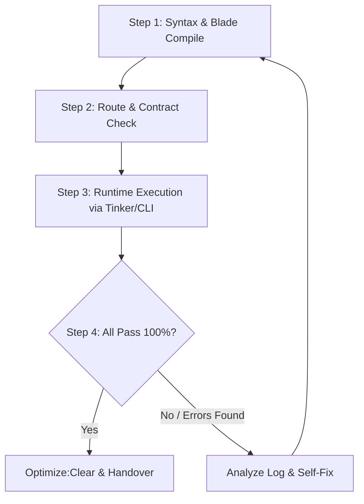

# Quy trình Kiểm thử Tự thân & Bàn giao Không Lỗi (Autonomous Self-Testing Loop)

> Quy định nghiêm ngặt: AI KHÔNG ĐƯỢC thông báo "hoàn thành" cho người dùng khi chưa tự mình chạy quy trình kiểm thử và xác minh 100% không còn lỗi.

---

## 1. Nguyên tắc Tham chiếu & Zero-Hardcode
1. **Tham chiếu Chức năng Cũ Tương tự (Pattern Reference)**:
   - Trước khi tạo hoặc chỉnh sửa bất kỳ module nào, AI BẮT BUỘC đọc và tham chiếu các file đang chạy ổn định trong codebase (Controller, Service, Repository, Blade component).
   - Bảo đảm tuân thủ Layered Architecture: `Controller → Service → Repository → Model`.
2. **Tuyệt đối Không Hardcode (Zero-Hardcode Mandatory)**:
   - Toàn bộ nội dung hiển thị phải lấy từ biến CSDL động (`$web`, `$product`, `$news`, `$page`, `$site_settings`).
   - Mọi URL phải thông qua helper `route(...)` hoặc `url(...)`.

---

## 2. Quy trình Xây dựng Chức năng Mới theo 6 Tầng
1. **Database Schema**: Tạo/sửa migration trong `database/migrations/` và ghi câu lệnh `ALTER TABLE` vào `database/patch_schema.sql`.
2. **Model & Traits**: Khai báo `$fillable`, `$casts`, gán quan hệ Eloquent và Traits tương ứng.
3. **Repository Layer**: Khai báo Interface trong `app/Repositories/Interfaces/` trước, sau đó implement trong `app/Repositories/Eloquent/`.
4. **Service Layer**: Viết business logic, transaction, xử lý cache trong `app/Services/`.
5. **Controller & Form Request**: Viết Form Request xác thực input (`app/Http/Requests/`), Controller chỉ điều hướng và gọi Service/Repository.
6. **Blade Views & Assets**: Sử dụng Blade Components Admin, CSS vào `theme-style.css`, JS vào `main.js`.

---

## 3. Vòng lặp Kiểm thử Tự thân 4 Bước (The Autonomous 4-Step Test Loop)



### Loop Step 1: Kiểm tra Cú pháp & Compile Blade
- Chạy PHP syntax lint: `php -l <file_path>` cho mọi file mới tạo hoặc vừa sửa.
- Biên dịch thử toàn bộ Blade Views:
  ```bash
  php artisan view:cache
  php artisan view:clear
  ```

### Loop Step 2: Toàn vẹn Route & Interface Contract
- Kiểm tra danh sách routes: `php artisan route:list` đảm bảo controller action tồn tại và route không bị xung đột.
- Kiểm tra Interface Contract: Xác nhận mọi method gọi từ Controller/Service đã được khai báo đầy đủ trong Interface Contract tương ứng.

### Loop Step 3: Runtime Test qua CLI / Tinker
- Kiểm tra gọi thử hàm Model / Repository / Service bằng mock data qua CLI:
  ```bash
  php artisan tinker --execute="..."
  ```
- Thử nghiệm các trường hợp biên (Edge cases): Dữ liệu rỗng `empty`, mảng rỗng `[]`, ID không tồn tại.

### Loop Step 4: Tự sửa chữa (Self-Correction & Loop Retry)
- Nếu gặp bất kỳ lỗi nào, AI tự phân tích stack trace, sửa file code ngay lập tức và **QUAY LẠI LOOP STEP 1**.
- Chỉ khi **TẤT CẢ 4 BƯỚC ĐỀU PASS 100%**, AI mới được xóa cache (`php artisan optimize:clear`) và thông báo hoàn thành cho người dùng.
