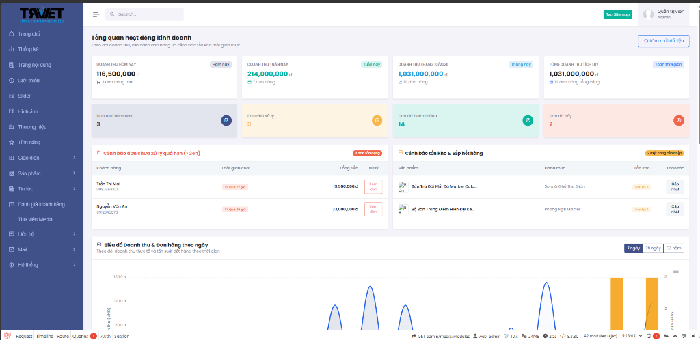
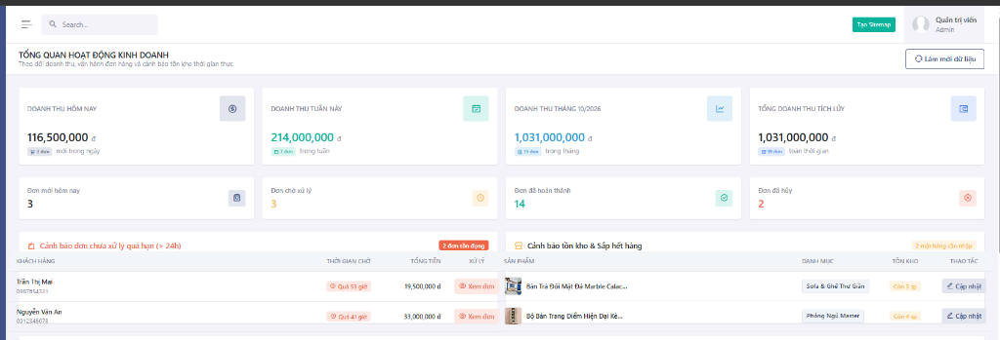
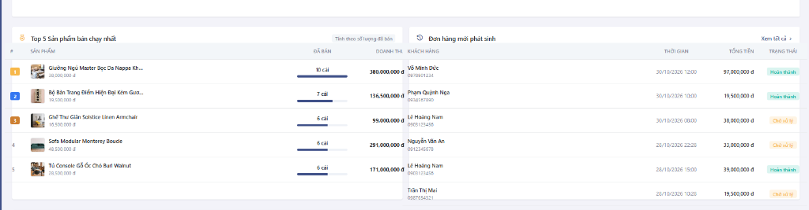

# Enterprise Laravel Base Foundation & AI-Ready Admin System

[](https://github.com/Thanhphuc1230/source_base_laravel/actions)
[](https://www.php.net/)
[](https://laravel.com/)
[](https://github.com/laravel/pint)
[](./.agents/architecture.md)
[](./.agents/AGENTS.md)
[](https://opensource.org/licenses/MIT)

> **Live Documentation & Interactive Guide:** [https://thanhphuc1230.github.io/source_base_laravel/](https://thanhphuc1230.github.io/source_base_laravel/)  
> **Repository:** [https://github.com/Thanhphuc1230/source_base_laravel](https://github.com/Thanhphuc1230/source_base_laravel)

---

### What is this repository?
A production-ready, enterprise-grade Laravel foundation engineered for high-performance ecommerce, corporate portals, and modern retail platforms. Designed specifically for software agencies, SaaS founders, and development teams who demand uncompromising code standards and zero technical debt.

### Core Highlights
* **Strict 4-Tier Layered Architecture**: Unidirectional flow (`Controller → Service → Repository → Model`) ensuring single responsibility, clean transactions, and clean testing.
* **17 Enforced Engineering Rules**: Zero-Hardcode policy, Zero-CDN offline assets, Redis query optimization, and unified media storage.
* **AI-Ready Codebase & Multi-Agent Squad**: Integrated `.agents/` squad (Lead Orchestrator, Backend Architect, Frontend Specialist, QA Inspector) with single-command context packing via Repomix.
* **Automated Self-Testing Loop**: Built-in 4-step autonomous test loop (Syntax, Interface Contracts, Runtime Execution via CLI, and Cache Clearing) to eliminate user-facing bugs.

---

## 📸 Admin Dashboard Overview

| Real-Time Business & Revenue Dashboard |
| :---: |
|  |

| Operational Warnings & Stock Health | Top Selling Products & Order Stream |
| :---: | :---: |
|  |  |

---

## 🏗️ 1. Layered Architecture

```text
HTTP Request ──► Controller ──► Service ──► Repository ──► Model (Eloquent) ──► Database
                      │             │
                      ▼             ▼
              Validation / JSON   Business Logic, DB Transactions, WebP Processing, Cache
```

* **Controller**: Responsible only for handling incoming HTTP requests, delegating to Service classes, and returning clean View/JSON responses. Raw database queries in controllers are strictly prohibited.
* **Service Layer**: Houses core business workflows, database transactions (`DB::transaction`), Redis cache orchestration, and automated image/media transformations.
* **Repository Layer**: Implements interface contracts (`RepositoryInterface`) for encapsulated, reusable Eloquent queries.
* **Model Layer**: Defines relationships, fillables, casting, and model traits (`AutoImagePathsTrait`, `SlugHandlerTrait`).

---

## 📌 2. The 17 Core Engineering Rules

Every change in this codebase adheres strictly to the 17 platform rules defined in [`.agents/AGENTS.md`](./.agents/AGENTS.md):

| # | Rule Name | Description & Requirement |
|:---:|---|---|
| **01** | **Zero-Hardcode** | 100% of visible content is dynamically managed via DB and Admin (`$web`, `$product`, `$news`). Static text in Blade is forbidden. |
| **02** | **Layered Architecture** | No database queries in Controllers. Follows `Controller → Service → Repository → Model`. |
| **03** | **Blade Components** | Admin uses reusable Blade components (`<x-admin.table-wrapper>`, `<x-admin.table-switch>`, `<x-admin.localized-fields>`). |
| **04** | **Cache Discipline** | Clear cache after code or config updates: `php artisan optimize:clear`. |
| **05** | **Anti-AI Design System** | Clean, realistic layouts (60/40 splits, spec tables, CTA bands); no generic pastel badges; mobile 2-column grid. |
| **06** | **Zero-CDN** | All assets (fonts, icons, JS, CSS) must be stored locally in `public/` for offline resilience. |
| **07** | **Separation of Concerns** | No inline styles or script tags in Blade files. All CSS lives in `theme-style.css`, and JS lives in `main.js`. |
| **08** | **Controlled Git Commits** | Commits require explicit user authorization. Conventional Commits in English only. |
| **09** | **Topic Rebuild** | Change niche/topic seamlessly using `php artisan site:rebuild --topic="<name>"`. |
| **10** | **Asset Concentration** | No scattered CSS/JS snippet files. Shared widgets live in `contact_buttons.blade.php`. |
| **11** | **English Code & Commits** | All code comments and Git commit messages must be in English. |
| **12** | **Unified Media Storage** | All media uploads are stored in `public/uploads/{module}/`. Videos use `#t=0.5` thumbnail frame previews. |
| **13** | **Modern Admin UI Standards** | Uniform 38px controls height, 32x32px ghost action buttons, single primary accent switches. |
| **14** | **Redis & Query Optimization** | Redis caching enabled. Hierarchy queries use optimized `whereIn` without redundant `orderBy`. |
| **15** | **Pattern Reference & Verification** | Reference existing modules before writing new code. Verify syntax and routes before completion. |
| **16** | **Instant Codebase Routing** | Locate files immediately using [`.agents/codebase-matrix.md`](./.agents/codebase-matrix.md) without blind recursive scanning. |
| **17** | **Autonomous Self-Testing Loop** | Mandatory 4-step test verification (Syntax, Interface Contract, Runtime Execution, Cache Clear) prior to turn delivery. |

---

## ⚡ 3. AI-Ready Codebase: Pack Context in One Command

This codebase includes a preconfigured [`repomix.config.json`](./repomix.config.json) that packages the entire project structure and critical source files into a single, structured XML document formatted for Large Language Models (Claude, GPT-4, Gemini):

### How to pack the codebase:
```bash
npx repomix
```

### Why it matters:
* **Instant Comprehension**: Feeds your LLM the exact architectural matrix, contracts, and patterns in 1-2 seconds.
* **Zero Noise**: Automatically filters out `vendor/`, `node_modules/`, `public/uploads/`, and temporary build artifacts.
* **Ready-to-Use Prompt Example**:
  > `@[repomix-output.xml] Analyze the checkout transaction pipeline in CheckoutService and verify that inventory stock decrementing is fully wrapped in DB::transaction.`

---

## 🔧 4. Installation & Quick Start

### Prerequisites
* PHP >= 8.2 with `pdo_mysql`, `mbstring`, `openssl`, `curl`, `gd` or `imagick`, `redis` extensions
* MySQL >= 8.0
* Composer >= 2.x

### Step-by-Step Setup
```bash
# 1. Clone the repository
git clone https://github.com/Thanhphuc1230/source_base_laravel.git
cd source_base_laravel

# 2. Install PHP dependencies
composer install

# 3. Environment configuration
cp .env.example .env
php artisan key:generate

# 4. Database configuration: Edit DB_* credentials in .env, then seed topic data
php artisan site:rebuild --topic="watches"

# 5. Optimize and clear cache
php artisan optimize:clear

# 6. Start local development server
php artisan serve
```

---

## 🔑 5. Default Administrative Access (Demo Seed Only)

> ⚠️ **DEMO SEED CREDENTIALS (CHANGE IN PRODUCTION)**:  
> The accounts below are generated exclusively by database seeders for local development, automated testing, and demonstration. **You MUST change these credentials or purge demo accounts immediately before deploying to any production environment.** These credentials must never be used in any live or public-facing deployment.

* **Login URL:** `/admin/login`

| Role | Demo Seed Email | Demo Seed Password | Permissions Scope |
|---|---|---|---|
| **Super Admin** | `admin@gmail.com` | `@admin123` | Full system access (All 61 permissions) |
| **Content Manager** | `manager@gmail.com` | `@admin123` | Catalog, inventory, and order operations |
| **Staff / Editor** | `staff@gmail.com` | `@admin123` | News articles, static pages, and media |

*Note: Demo seed credentials, change in production.*

---

## 👥 6. The Multi-Agent AI Engineering Squad

Located in the [`.agents/`](./.agents/) directory, the squad provides dedicated role definitions and skills:

* **[Lead Orchestrator](.agents/roles/orchestrator.md)**: Task decomposition, cross-specialist coordination, and Git control (Rule 8).
* **[Backend Architect](.agents/roles/backend-architect.md)**: Layered architecture, DB migrations, repositories, and cache strategy.
* **[Frontend Specialist](.agents/roles/frontend-specialist.md)**: Blade views, responsive design (Mobile 2-column grid), Zero-CDN, and anti-AI styling.
* **[QA Inspector](.agents/roles/qa-inspector.md)**: Zero-Hardcode scanner, route integrity checks, and media asset validation.

---

## 📄 License & Attribution

This project is open-source software licensed under the [MIT License](https://opensource.org/licenses/MIT).
Created & maintained by [Thanh Phuc](https://github.com/Thanhphuc1230).
