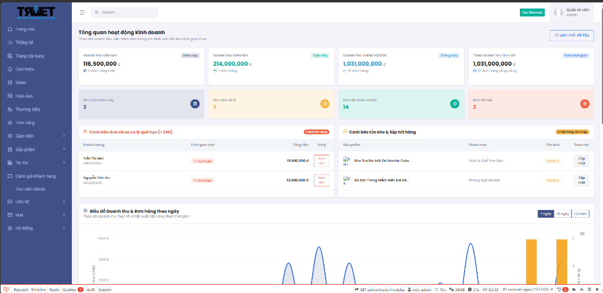
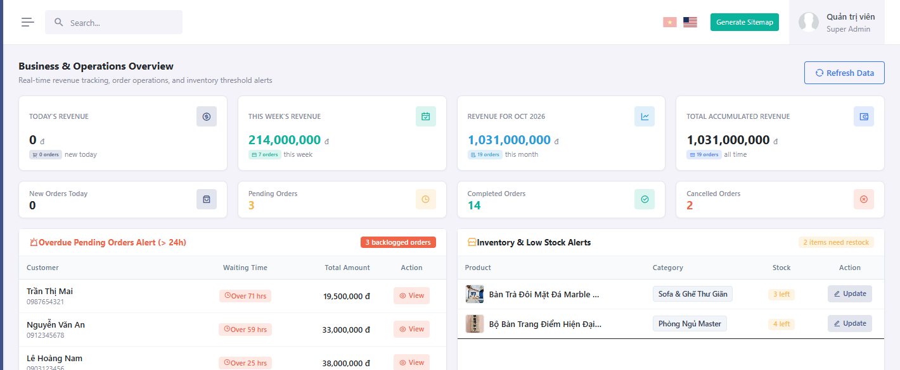
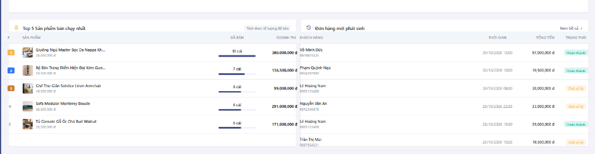

# Enterprise Laravel Base Foundation & AI-Ready Admin System

[](https://github.com/Thanhphuc1230/source_base_laravel/actions)
[](https://www.php.net/)
[](https://laravel.com/)
[](https://github.com/Thanhphuc1230/source_base_laravel/security/dependabot)
[](https://github.com/laravel/pint)
[](./.agents/architecture.md)
[](./.agents/AGENTS.md)
[](https://opensource.org/licenses/MIT)

> **Live Documentation & Interactive Guide:** [https://thanhphuc1230.github.io/source_base_laravel/](https://thanhphuc1230.github.io/source_base_laravel/)  
> **Repository:** [https://github.com/Thanhphuc1230/source_base_laravel](https://github.com/Thanhphuc1230/source_base_laravel)

---

### What is this repository?
A production-ready, enterprise-grade Laravel foundation engineered for high-performance ecommerce, corporate portals, and modern retail platforms. Designed specifically for software agencies, SaaS founders, and development teams who demand uncompromising code standards and zero technical debt.

### Core Highlights
* **Strict 4-Tier Layered Architecture**: Unidirectional flow (`Controller → Service → Repository → Model`) ensuring single responsibility, clean transactions, and clean testing.
* **20 Enforced Engineering Rules**: Zero-Hardcode policy, Zero-CDN offline assets, Redis query optimization, unified media storage, technical SEO schema, Cloudflare Edge caching, and Google PageSpeed 95-100 Core Web Vitals.
* **AI-Ready Codebase & Multi-Agent Squad**: Integrated `.agents/` squad (Lead Orchestrator, Backend Architect, Frontend Specialist, QA Inspector) with single-command context packing via Repomix. Xem hướng dẫn chi tiết & benchmark tại [`README_AI.md`](./README_AI.md).
* **Automated Self-Testing Loop**: Built-in 4-step autonomous test loop (Syntax, Interface Contracts, Runtime Execution via CLI, and Cache Clearing) to eliminate user-facing bugs.

---

## 📸 Admin Dashboard Overview

| Real-Time Business & Revenue Dashboard |
| :---: |
|  |

| Operational Warnings & Stock Health | Top Selling Products & Order Stream |
| :---: | :---: |
|  |  |

---

## 🏗️ 1. Layered Architecture

```text
HTTP Request ──► Controller ──► Service ──► Repository ──► Model (Eloquent) ──► Database
                      │             │
                      ▼             ▼
              Validation / JSON   Business Logic, DB Transactions, WebP Processing, Cache
```

* **Controller**: Responsible only for handling incoming HTTP requests, delegating to Service classes, and returning clean View/JSON responses. Raw database queries in controllers are strictly prohibited.
* **Service Layer**: Houses core business workflows, database transactions (`DB::transaction`), Redis cache orchestration, and automated image/media transformations.
* **Repository Layer**: Implements interface contracts (`RepositoryInterface`) for encapsulated, reusable Eloquent queries.
* **Model Layer**: Defines relationships, fillables, casting, and model traits (`AutoImagePathsTrait`, `SlugHandlerTrait`).

---

## 📌 2. The 20 Core Engineering Rules

Every change in this codebase adheres strictly to the 20 platform rules defined in [`.agents/AGENTS.md`](./.agents/AGENTS.md):

| # | Rule Name | Description & Requirement |
|:---:|---|---|
| **01** | **Zero-Hardcode** | 100% of visible content is dynamically managed via DB and Admin (`$web`, `$product`, `$news`). Static text in Blade is forbidden. |
| **02** | **Layered Architecture** | No database queries in Controllers. Follows `Controller → Service → Repository → Model`. |
| **03** | **Blade Components** | Admin uses reusable Blade components (`<x-admin.table-wrapper>`, `<x-admin.table-switch>`, `<x-admin.localized-fields>`). |
| **04** | **Cache Discipline** | Clear cache after code or config updates: `php artisan optimize:clear`. |
| **05** | **Anti-AI Design System** | Clean, realistic layouts (60/40 splits, spec tables, CTA bands); no generic pastel badges; mobile 2-column grid. |
| **06** | **Zero-CDN** | All assets (fonts, icons, JS, CSS) must be stored locally in `public/` for offline resilience. |
| **07** | **Separation of Concerns** | No inline styles or script tags in Blade files. All CSS lives in `theme-style.css`, and JS lives in `main.js`. |
| **08** | **Controlled Git Commits** | Commits require explicit user authorization. Conventional Commits in English only. |
| **09** | **Topic Rebuild** | Change niche/topic seamlessly using `php artisan site:rebuild --topic="<name>"`. |
| **10** | **Asset Concentration** | No scattered CSS/JS snippet files. Shared widgets live in `contact_buttons.blade.php`. |
| **11** | **English Code & Commits** | All code comments and Git commit messages must be in English. |
| **12** | **Unified Media Storage** | All media uploads are stored in `public/uploads/{module}/`. Videos use `#t=0.5` thumbnail frame previews. |
| **13** | **Modern Admin UI Standards** | Uniform 38px controls height, 32x32px ghost action buttons, single primary accent switches. |
| **14** | **Redis & Query Optimization** | Redis caching enabled. Hierarchy queries use optimized `whereIn` without redundant `orderBy`. |
| **15** | **Pattern Reference & Verification** | Reference existing modules before writing new code. Verify syntax and routes before completion. |
| **16** | **Instant Codebase Routing** | Locate files immediately using [`.agents/codebase-matrix.md`](./.agents/codebase-matrix.md) without blind recursive scanning. |
| **17** | **Autonomous Self-Testing Loop** | Mandatory 4-step test verification (Syntax, Interface Contract, Runtime Execution, Cache Clear) prior to turn delivery. |
| **18** | **Technical & On-Page SEO** | Dynamic cached `/sitemap.xml`, secure `robots.txt`, single semantic `<h1>` per page, complete JSON-LD Schemas (LocalBusiness, Product, NewsArticle, Breadcrumbs), OpenGraph & Twitter Cards. |
| **19** | **Origin Performance & Cloudflare Edge** | Pruned column queries (no `select *` in catalog/home), multi-tier cache, and standard 2-rule Cloudflare Edge Cache (`Bypass Admin` & `Cache Frontend Everything`). |
| **20** | **PageSpeed 95-100 & A11y Standards** | Backend auto-resize WebP (<800px card, <1600px hero), `aspect-ratio` + explicit width/height (CLS=0), LCP `fetchpriority="high"`, below-fold lazy/async, non-blocking icon CSS, deferred JS, 44x44px tap targets, strict heading hierarchy, and CSRF anti-419 edge protection. |

---

## ⚡ 3. AI Optimization, Benchmarks & Base Prompts

This repository is pre-optimized for **Antigravity**, **Cursor**, **Windsurf**, and CLI-based AI assistants (Claude Code, Gemini, Codex). It includes automated context packers, an AST search engine, background indexing shields, and an instant function signature skeleton generator.

### 3.1. Developer & AI Command Reference

```bash
# 1. Pack Core Architecture Context (Recommended: Models, Repos, Services, Routes ~102k tokens)
npm run context:summary

# 2. Pack Complete Repository Context (Full codebase ~380k tokens)
npm run context:full

# 3. Regenerate Instant Codebase Skeleton Map (<0.8s execution)
php tools/generate-codebase-skeleton.php

# 4. AST Semantic Code Search via ast-grep
npm run ast -- -p 'public function $METHOD(Request $request) { $$$ }' app/Http/Controllers

# 5. Clear System Caches
php artisan optimize:clear
```

---

### 3.2. Performance Benchmark: Before vs After Optimization

| Benchmark Metric | Before Optimization | After Optimization | Performance Gain |
|---|---|---|:---:|
| **Base System Prompt Overhead (`AGENTS.md`)** | ~8,700 tokens (36.8 KB, 375 lines) | **~1,100 tokens** (6.1 KB, 76 lines) | **-87.3% token waste** |
| **System Prompt Truncation Risk** | High (tail rules frequently cut off) | **0% (Lightweight Master Router)** | **Eliminates truncation** |
| **Core Architecture Context Pack** | ~380,000 tokens (1.5 MB XML) | **102,549 tokens** (385 KB XML) | **-73.0% context size** |
| **Function Signature & Eloquent Lookup** | 5-15 raw files (~15k tokens, 10-20s) | Read skeleton snippet (**~200 tokens, <0.1s**) | **100x faster, -98.6% tokens** |
| **Background Indexing & File Watcher Load** | ~25,000+ files (`vendor`, `uploads`, cache) | **Shielded via `.antigravityignore`** | **Saved >12,000 files & >100MB I/O** |
| **Skeleton Map Generation Time** | _No automated tool_ | **<0.8s** (`generate-codebase-skeleton.php`) | **Instantaneous** |
| **IDE / Watcher Hangs & Disk I/O Lag** | Frequent during composer/npm file events | **Completely eliminated** | **Instant responsiveness** |

---

### 3.3. Standard Base Prompts for AI Coding Assistants (English)

Copy and paste these verified base prompts into your AI coding assistant (Antigravity, Cursor, Windsurf, Claude Code, ChatGPT, Gemini) to guarantee 100% architectural adherence:

#### 🟢 Prompt 1: Session Initialization & Architecture Invariants (Recommended Kickoff)
```markdown
You are an expert full-stack engineer working on this Laravel codebase.
Before writing or analyzing code, read `.agents/AGENTS.md` and adhere strictly to the 3 Core Invariants:
1. Zero-Hardcode: 100% of visible frontend text, contact info, and media must come from the database or `$web`. No static text in Blade.
2. Layered Architecture: Maintain `Controller -> Service -> Repository -> Model`. Do not write database queries in Controllers.
3. Strict Git Protocol: Do not commit or push without explicit user confirmation. Commit messages must use English Conventional Commits.

To locate existing classes and methods instantly without blind file scanning, reference `.agents/codebase-skeleton.md` and `.agents/codebase-matrix.md`.
```

#### 🔵 Prompt 2: New Feature / Module Implementation (6-Tier Pipeline)
```markdown
Implement the following feature: "[FEATURE_NAME_AND_REQUIREMENTS]".

Follow the strict 6-tier architecture pipeline:
1. Database Schema: Update migration and append SQL statements to `database/patch_schema.sql`.
2. Model & Traits: Define `$fillable`, `$casts`, and Eloquent relations (`belongsTo`, `hasMany`).
3. Repository Layer: Declare interface in `app/Repositories/Interfaces/` and implement in `app/Repositories/Eloquent/`.
4. Service Layer: Implement business logic, DB transactions (`DB::transaction`), and cache invalidation in `app/Services/`.
5. Controller & Request: Create dedicated FormRequest for input validation. Controller only delegates to Service/Repository.
6. Admin Blade Views: Use `<x-admin.table-wrapper>`, uniform 38px controls, and 32x32px ghost action buttons (refer to `.agents/rules/04-admin-ui-ux.md`).

Execute the Autonomous 4-Step Test Loop before completing:
- Syntax lint: `php -l <path>` and Blade compile: `php artisan view:cache && php artisan view:clear`.
- Verify routes: `php artisan route:list`.
- Run runtime check via tinker if applicable.
- Refresh cache: `php artisan optimize:clear`.
```

#### 🟡 Prompt 3: Frontend Customization & Theme Styling (Anti-AI Design)
```markdown
Customize the frontend view: "[PAGE_OR_SECTION_NAME]".

Strict frontend constraints (refer to `.agents/rules/03-anti-ai-design-system.md`):
1. Zero-Hardcode: All labels, banners, titles, and copy must come from `$web`, `$product_settings`, or dynamic model variables.
2. Anti-AI Design:
   - 1200px max container (`container-b2b`), uniform 8px border-radius (`rounded-[8px]`). No pill buttons (`rounded-full`).
   - Balanced equal-height product cards (`h-full flex flex-col justify-between`, image 1:1 `aspect-square`).
   - Mobile: Products and news must render in a 2-column grid (`grid grid-cols-2 gap-3`).
3. Zero-CDN & Asset Consolidation:
   - Do not import external CDN scripts/styles.
   - Append custom CSS to `public/frontend/css/theme-style.css` and JS to `public/frontend/js/main.js`.
4. Run `php artisan optimize:clear` once done.
```

#### 🟣 Prompt 4: QA Inspection & Zero-Hardcode Audit
```markdown
Perform an automated QA inspection on the recent changes in `[DIRECTORY_OR_FILES]`:
1. Check for hardcoded Vietnamese strings or static URLs inside Blade files.
2. Verify that all repository method calls from Controllers exist in their respective Interface contracts.
3. Verify that all responsive layouts conform to mobile 2-column standards.
4. Run syntax linting and `php artisan route:list` to verify route integrity.
Report all findings and provide surgical code fixes for any violations found.
```

---

---

## 🔧 4. Installation & Quick Start

### Prerequisites
* PHP >= 8.3 with `pdo_mysql`, `mbstring`, `openssl`, `curl`, `gd` or `imagick`, `redis` extensions
* MySQL >= 8.0
* Composer >= 2.x

### Step-by-Step Setup
```bash
# 1. Clone the repository
git clone https://github.com/Thanhphuc1230/source_base_laravel.git
cd source_base_laravel

# 2. Install PHP dependencies
composer install

# 3. Environment configuration
cp .env.example .env
php artisan key:generate

# 4. Database configuration: Edit DB_* credentials in .env, then seed topic data
php artisan site:rebuild --topic="watches"

# 5. Optimize and clear cache
php artisan optimize:clear

# 6. Start local development server
php artisan serve
```

---

## 🔑 5. Default Administrative Access (Demo Seed Only)

> ⚠️ **DEMO SEED CREDENTIALS (CHANGE IN PRODUCTION)**:  
> The accounts below are generated exclusively by database seeders for local development, automated testing, and demonstration. **You MUST change these credentials or purge demo accounts immediately before deploying to any production environment.** These credentials must never be used in any live or public-facing deployment.

* **Login URL:** `/admintv`

| Role | Demo Seed Email | Demo Seed Password | Permissions Scope |
|---|---|---|---|
| **Super Admin** | `admin@gmail.com` | `@admin123` | Full system access (All 61 permissions) |
| **Content Manager** | `manager@gmail.com` | `@admin123` | Catalog, inventory, and order operations |
| **Staff / Editor** | `staff@gmail.com` | `@admin123` | News articles, static pages, and media |

*Note: Demo seed credentials, change in production.*

---

## 👥 6. The Multi-Agent AI Engineering Squad

Located in the [`.agents/`](./.agents/) directory, the squad provides dedicated role definitions and skills:

* **[Lead Orchestrator](.agents/roles/orchestrator.md)**: Task decomposition, cross-specialist coordination, and Git control (Rule 8).
* **[Backend Architect](.agents/roles/backend-architect.md)**: Layered architecture, DB migrations, repositories, and cache strategy.
* **[Frontend Specialist](.agents/roles/frontend-specialist.md)**: Blade views, responsive design (Mobile 2-column grid), Zero-CDN, and anti-AI styling.
* **[QA Inspector](.agents/roles/qa-inspector.md)**: Zero-Hardcode scanner, route integrity checks, and media asset validation.

---

## 📄 License & Attribution

This project is open-source software licensed under the [MIT License](https://opensource.org/licenses/MIT).
Created & maintained by [Thanh Phuc](https://github.com/Thanhphuc1230).
